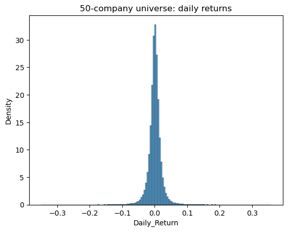
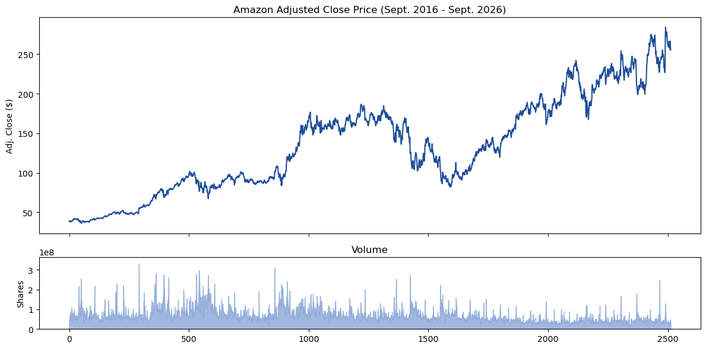
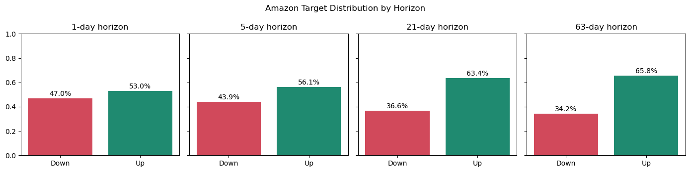
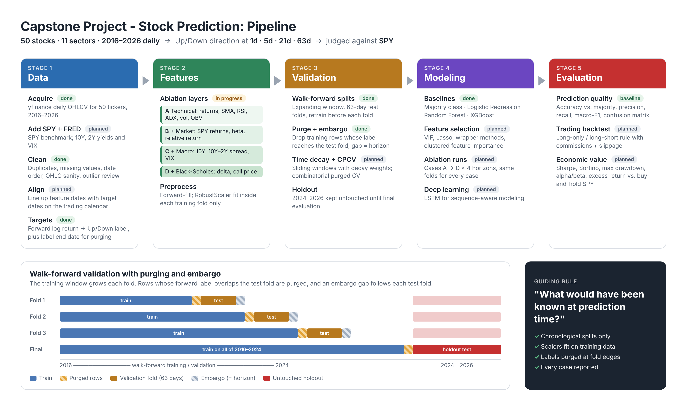
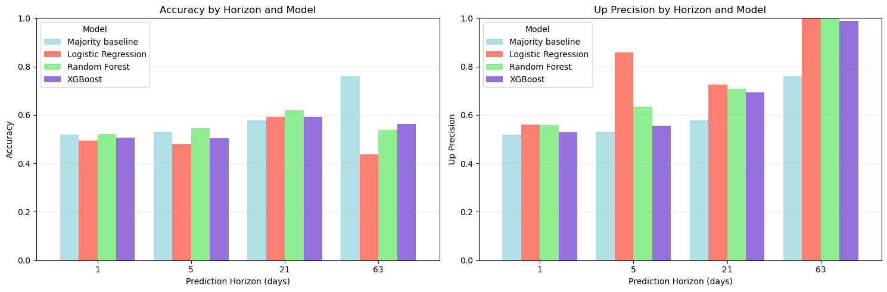
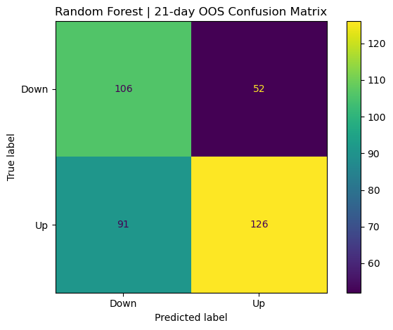

# Capstone Project - Stock Prediction
### Cross-Horizon Equity Return Prediction

> **Does adding market, interest-rate, and volatility information improve directional stock-return forecasts across horizons, and does any edge survive contact with a trading strategy?**

**Team:** Frances Wint · Zuhair Syd · Manya Vikal · Annie Tran
**Course:** Data Science Capstone I → II

| | |
|---|---|
| **Universe** | 50 large-cap U.S. stocks across 11 sectors |
| **Period** | Sept 1, 2016 – Sept 1, 2026 (10 years, daily) |
| **Target** | Binary direction (Up / Down) of forward log return |
| **Horizons** | 1 day · 5 days · 21 days (~1 month) · 63 days (~1 quarter) |
| **Benchmark** | SPY (S&P 500 ETF) |
| **Status** | ✅ Data acquisition · ✅ EDA · ✅ Baseline (Amazon subset) · 🔄 Feature engineering · ⏳ Ablation, deep learning, backtest |

---

## Table of Contents
1. [Motivation](#motivation)
2. [Research Questions](#research-questions)
3. [Our Contribution: A Controlled Feature Ablation](#our-contribution-a-controlled-feature-ablation)
4. [Data](#data)
5. [Exploratory Data Analysis](#exploratory-data-analysis)
6. [Methodology](#methodology)
7. [Baseline Results](#baseline-results)
8. [Repository Structure](#repository-structure)
9. [Getting Started](#getting-started)
10. [Roadmap](#roadmap)
11. [References](#references)

---

## Motivation

Return forecasts sit underneath nearly every large financial decision: retirement portfolios, pension allocations, and algorithmic trading desks all depend on some belief about what an asset will do next. But stock returns are **noisy, nonstationary, and driven by interacting market, company, and macro conditions**, and a model that looks good on historical data can fall apart once the information available at prediction time changes.

Machine learning has shown modest gains over classical linear models, but *which specific layer of information actually earns its keep* is rarely tested in isolation.

**Our goal is not to claim that markets are predictable.** It is to test whether a disciplined feature / model / validation design produces *repeatable out-of-sample information* relative to a market benchmark.

---

## Research Questions

| # | Question |
|---|---|
| **RQ1** | Can daily market, technical, macro, and Black-Scholes-derived features predict a stock's future relative performance vs. SPY? |
| **RQ2** | Does predictive performance change across 1-day, 5-day, 21-day, and 63-day horizons? |
| **RQ3** | Which feature family produces measurable incremental out-of-sample value? |
| **RQ4** | Do classification gains translate into economically meaningful results after benchmark comparison, turnover, and transaction costs? |

---

## Our Contribution: A Controlled Feature Ablation

Most prior work throws a broad predictor set at the model from the start. We add information **one layer at a time** and evaluate every case identically across all four horizons:

```
 Case A            Case B             Case C                     Case D
 Technical   ──▶   + SPY market  ──▶  + Treasury yield /    ──▶  + Black-Scholes-
 indicators        features           term spread / VIX          motivated volatility
```

This isolates *which information layer buys predictive power, and at which horizon*.

<details>
<summary><b>Planned feature set (click to expand)</b></summary>

**A — Technical indicators**
- Log returns (1d / 5d / 21d / 63d)
- Price / SMA (20 / 50 / 200)
- RSI-14, ADX-14
- Rolling volatility (10d / 60d)
- Relative volume (Volume / VMA 20, 60)
- Bollinger %B
- OBV 10-day slope

**B — Market information (SPY)**
- SPY log returns (1d / 5d / 20d)
- SPY 20-day volatility
- SPY price / SMA-50
- Stock-minus-SPY relative return
- Rolling beta to SPY (20d / 60d)

**C — Macroeconomic**
- 10Y Treasury yield and its 1d / 5d change
- 10Y – 2Y term spread
- VIX level and 1d / 5d change

**D — Black-Scholes**
- BS delta
- BS call price

</details>

---

## Data

**Source:** [`yfinance`](https://github.com/ranaroussi/yfinance) (prices); [FRED](https://fred.stlouisfed.org/) (macro series, upcoming)

**Stock universe — 50 tickers, 11 sectors**

| Sector | Tickers |
|---|---|
| Technology | AAPL, MSFT, NVDA, AVGO, AMD, ORCL, CSCO, CRM, ADBE, INTC |
| Consumer Staples | WMT, COST, KO, PG |
| Health Care | LLY, JNJ, UNH, ABBV, PFE |
| Energy | XOM, CVX, COP |
| Financials | JPM, BAC, GS, V, BLK |
| Utilities | NEE, DUK, SO |
| Consumer Discretionary | AMZN, TSLA, HD, MCD, NKE |
| Materials | LIN, SHW, APD |
| Industrials | CAT, GE, HON, RTX, UPS |
| Real Estate | PLD, AMT, O |
| Communication | GOOGL, META, NFLX, DIS |

**Raw fields (daily):** `Date`, `Open`, `High`, `Low`, `Close`, `Adj Close` (split- and dividend-adjusted), `Volume`, `Ticker`

| File | Shape | Notes |
|---|---|---|
| `data/raw/universe_50.csv` | 125,650 rows × 8 cols | Long format, 2,513 trading days per ticker |
| `data/raw/amzn.csv` | 2,513 rows × 6 cols | Amazon subset used for prototyping; `Close` replaced by `Adj_Close` |

**Data-quality checks (both files):** ✅ no missing values · ✅ no duplicate ticker-date rows · ✅ chronologically sorted · ✅ no zero/negative prices · ✅ no `High < Low` or inconsistent OHL days

---

## Exploratory Data Analysis

### Return distributions
Across the 50 stocks, the average daily return is **≈0.08%** with a daily standard deviation of **≈1.9%**. Returns are sharply peaked with fat tails. **110** single-day moves exceeded ±15% (e.g. NFLX −35% on 2022-04-20, ORCL +36% on 2025-09-10). These are real earnings and macro events, not data errors, so they are kept.



### Amazon prototype subset
Amazon (AMZN) is the development stock: mean daily return 0.097%, std 2.09%, and only one move above 15% (+15.3% on 2026-07-31).



### Target distribution: class imbalance grows with horizon
Because stocks drift upward over time, the share of **Up** labels increases with the horizon. That makes a "always predict Up" model look deceptively strong at long horizons, so we report macro-F1 and Down-class recall, not accuracy alone.



| Horizon | 1d | 5d | 21d | 63d |
|---|---|---|---|---|
| % Up | 53.0% | 56.1% | 63.4% | 65.8% |

---

## Methodology

> Every step is built around one question: **"What would have been known at prediction time?"**



### Target construction
For each horizon *h* ∈ {1, 5, 21, 63}:

$$
r_{t,h} = \ln\left(\frac{P_{t+h}}{P_t}\right), \qquad y_{t,h} = \mathbb{1}[r_{t,h} > 0]
$$

The label's end date (*t + h*) is stored alongside every row so it can be used for purging.

### Leakage-controlled validation
- **Training / validation:** 2016 – Sept 2024; **out-of-sample holdout:** Sept 2024 – 2026, left untouched until final evaluation
- **Walk-forward expanding window:** 63-trading-day test folds, retraining before each fold
- **Purging:** any training row whose label end date reaches into the test fold is dropped
- **Embargo:** a gap equal to the horizon after each test fold
- **Planned:** sliding windows with exponential time-decay weights and Combinatorial Purged Cross-Validation (CPCV)

### Models
| Model | Type | Role |
|---|---|---|
| Majority baseline | Rule-based | The floor every model must beat |
| Logistic Regression | Linear | Interpretable, low-complexity comparison model |
| Random Forest | Bagged trees | Captures nonlinear interactions |
| XGBoost | Gradient-boosted trees | Strong nonlinear tabular model |
| LSTM *(planned)* | Deep learning | Sequence-aware modeling |

### Evaluation
- **Prediction quality:** accuracy vs. naive baseline, precision (a false "buy" costs real money), recall, macro-F1, confusion matrices
- **Economic value (planned):** Sharpe and Sortino ratios after transaction costs, annualized and excess return vs. SPY, maximum drawdown, alpha and beta

### Challenges and mitigations
| Challenge | Mitigation |
|---|---|
| Data leakage | Chronological walk-forward splits, scalers fit on train only, purged and embargoed CV |
| Non-stationarity | Log returns; exponential time-decay sample weights |
| Backtest optimism | Untouched final holdout; report *all* cases; deflated-Sharpe skepticism |
| Class imbalance | Macro-F1, balanced accuracy, threshold sensitivity, class-aware training |
| Overfitting | Regularization; expanding from 1 to 50 stocks |

---

## Baseline Results

*Amazon only · raw OHLCV inputs (no engineered features yet) · walk-forward out-of-sample folds*



| Horizon | Model | Accuracy | Up Precision | Down Recall | Macro F1 |
|---|---|---|---|---|---|
| **1d** | Majority baseline | 51.9% | 51.9% | 0.0% | 0.342 |
| | Logistic Regression | 49.5% | 55.9% | 89.0% | 0.419 |
| | Random Forest | **52.1%** | 55.8% | 67.5% | **0.513** |
| | XGBoost | 50.5% | 52.8% | 56.5% | 0.504 |
| **5d** | Majority baseline | 53.2% | 53.2% | 0.0% | 0.347 |
| | Logistic Regression | 47.9% | 85.7% | 99.5% | 0.345 |
| | Random Forest | **54.5%** | 63.4% | 77.8% | **0.528** |
| | XGBoost | 50.3% | 55.6% | 70.8% | 0.490 |
| **21d** | Majority baseline | 57.9% | 57.9% | 0.0% | 0.367 |
| | Logistic Regression | 59.2% | 72.5% | 75.3% | 0.591 |
| | Random Forest | **61.9%** | 70.8% | 67.1% | **0.618** |
| | XGBoost | 59.2% | 69.3% | 67.7% | 0.592 |
| **63d** | Majority baseline | **75.9%** | 75.9% | 0.0% | 0.432 |
| | Logistic Regression | 43.8% | 100.0% | 100.0% | 0.437 |
| | Random Forest | 53.8% | 100.0% | 100.0% | 0.537 |
| | XGBoost | 56.2% | 98.8% | 98.3% | **0.559** |



**Takeaways**
- At **1d and 5d**, every model is close to a coin flip. Raw prices carry little short-term directional signal, which is consistent with the literature.
- **21d is the sweet spot so far:** Random Forest beats the majority baseline on accuracy (+4.0 pts) and lifts macro-F1 from 0.37 to 0.62.
- At **63d**, the majority baseline "wins" on accuracy only because ~76% of the test labels are Up. The models over-predict Down, and there are only 4 test folds, so this horizon needs more data (the 50-stock expansion) before we draw conclusions.
- These numbers set the **floor** that the Case A–D ablations have to beat.

---

## Repository Structure

```
<your-repo-name>/
├── data/
│   └── raw/
│       ├── universe_50.csv          # 50-ticker daily OHLCV panel (long format)
│       └── amzn.csv                 # Amazon prototype subset
├── notebooks/
│   ├── 01_Download_Data.ipynb       # yfinance download, reshape, sanity checks, save
│   └── 02_eda_targets_baseline.ipynb# EDA, target labels, walk-forward baselines
├── figures/                         # Charts used in this README
└── README.md
```

---

## Getting Started

```bash
git clone https://github.com/<An-n-nie>/<CapSTOKED>.git
cd <CapSTOKED>
python -m venv .venv && source .venv/bin/activate
pip install -r requirements.txt
jupyter lab
```

**`requirements.txt`**
```
pandas>=2.2
numpy>=1.26
yfinance>=1.0
matplotlib
seaborn
scikit-learn
xgboost
jupyterlab
```

Run the notebooks in order:
1. `01_Download_Data.ipynb` writes `data/raw/universe_50.csv` and `data/raw/amzn.csv`
2. `02_eda_targets_baseline.ipynb` runs EDA, builds targets, and produces the baseline results above

> **Note:** Yahoo Finance revises adjusted prices retroactively when new dividends or splits occur, so re-downloading may give slightly different values. The CSVs committed in `data/raw/` are the snapshot used for all reported results.

---

## Roadmap

**Capstone I**
- [x] Research question and literature review
- [x] Data acquisition and data-quality checks
- [x] EDA and target construction
- [x] Walk-forward baseline on the Amazon subset
- [ ] Feature engineering (Cases A–D)
- [ ] Expand modeling to the full 50-stock universe

**Capstone II**
- [ ] Walk-forward ML ablation across all horizons
- [ ] Deep learning (LSTM)
- [ ] Feature selection (VIF, Lasso, wrapper, CFI)
- [ ] Trading simulation: long-only / long-short rule, transaction costs, vs. buy-and-hold SPY
- [ ] Final evaluation on the untouched 2024–2026 holdout
- [ ] Final product (reproducible repo and/or interactive dashboard)

---

## References

- Fischer, T., & Krauss, C. (2018). Deep learning with long short-term memory networks for financial market predictions. *European Journal of Operational Research, 270*(2), 654–669. https://doi.org/10.1016/j.ejor.2017.11.054
- Gu, S., Kelly, B., & Xiu, D. (2020). Empirical asset pricing via machine learning. *Review of Financial Studies, 33*(5), 2223–2273. https://doi.org/10.1093/rfs/hhaa009
- Mostafa, S. E., Ahmed, Y., Solayman, M., & Darwish, F. (2026). A hybrid LSTM–XGBoost framework for multi-horizon stock return prediction across diversified equity portfolios. *arXiv*. https://doi.org/10.48550/arXiv.2609.13125
- Wolff, D., & Echterling, F. (2024). Stock picking with machine learning. *Journal of Forecasting, 43*(1), 81–102. https://doi.org/10.1002/for.3021
- Zhong, S., & Hitchcock, D. B. (2021). S&P 500 stock price prediction using technical, fundamental and text data. *arXiv:2108.10826*. https://arxiv.org/abs/2108.10826

---

*This project is for academic research only and is not investment advice.*
